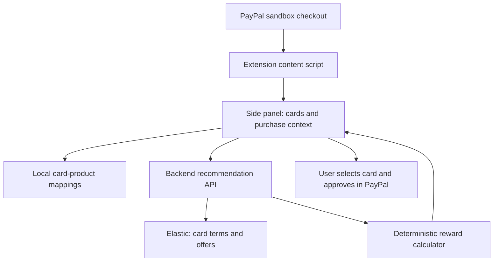

# PayPal Card Rewards Extension — Development Plan

> Historical planning document. For current implemented behavior and remaining work, use [SPEC.md](SPEC.md) and [TASKS.md](TASKS.md).

## Objective

Build a browser extension that reads PayPal sandbox checkout context, asks users
to identify their card products once, and recommends the best card before they
approve payment. The user selects the funding source and completes payment in PayPal.

The first feasibility gate is whether checkout exposes selectable cards, merchant,
amount, and currency. Wallet screenshots establish what Wallet displays; checkout
access has not yet been verified. The existing Playwright inspector has not
completed an authenticated inspection.

## MVP scope

- Our own demo merchant checkout, configured entirely for PayPal sandbox.
- Chrome extension using Manifest V3.
- PayPal sandbox checkout support.
- Detection of cards visible in the checkout funding-source selector.
- One-time, user-confirmed issuer and product mapping for each detected card.
- A small, verified rewards catalog and clearly labeled demo offers.
- Recommendations with estimated value, conditions, source links, and freshness.
- Manual card selection and payment approval in PayPal.

“Cards detected” means cards the extension actually observes, not the entire wallet.
Sandbox cards must be mapped to demo reward profiles; they do not establish real
issuer reward entitlements.

## Implementation status

- Main site rebuilt as a Channel3 storefront with department browsing, search,
  live offers, product dialog, quantity selection, server-owned quotes, and PayPal
  sandbox checkout. Channel3 search removed from the extension. Store department
  rewards categories are explicitly simulated; extension recommendations and
  persistent savings retain their existing flow.

- Payment-completion savings tracking added in SQLite. Quote snapshots and verified
  captures are associated with a private browser-installation identifier. The UI
  reports incremental estimated reward savings and cumulative totals, with unknown
  baseline/selection excluded and duplicate capture counting prevented. Actual
  rewards settlement/refund reconciliation remains outside the prototype.

- Phase 0 implemented locally: sandbox SDK setup, server-owned prices,
  session-bound orders, durable retry IDs, verified captures, and error UI.
- Extension shell, visible-label parser, local mappings, correction fields, and
  comparison UI implemented. Real PayPal checkout compatibility is unverified.
- Authenticated sandbox Wallet inspection succeeded: the extension extractor
  detected Amex ending 2402 and Visa ending 6302 with distinct page references.
  Detail pages exposed expiration dates and preference controls. Gold/Platinum
  product identity and rewards were not exposed by the extracted labels.
- Cashback calculator supports synthetic rules, caps, activation, expiry, and exclusions.
- Optional Elastic retrieval and demo seeding implemented; deployment unverified.
- Sourced card-catalog upload to Elastic Cloud completed: four documents, with
  document count and Amex Gold grocery retrieval verified. Synthetic reward-rules
  seeding and comparison integration remain separate.
- Official-source datasource added: four US card profiles, 16 advertised reward
  summaries, repeatable scraping, a separate nested Elastic card-catalog index,
  and catalog lookup API. The panel now uses a sourced single-card recommendation
  endpoint, with explicit point-value/cap assumptions. Full terms and PayPal
  eligibility remain unreviewed; the legacy synthetic calculator is not used by the panel.
- Tests cover local HTTP behavior, ownership/retries, reward math, card fixtures,
  and browser UI with simulated external APIs.
- Remaining gates: authenticated multi-card checkout,
  actual extension installation, verified issuer data, real Elastic integration,
  and later points/AI/hosting work. See README for setup and limitations.

## User flow

1. User selects a demo purchase on our checkout and opens PayPal sandbox checkout.
2. User clicks the extension toolbar icon. Optionally display an in-page launcher
   after detecting checkout.
3. A side panel shows merchant, amount, currency, detected card count, and masked labels.
4. For each unmapped card, the user selects issuer, product, country, and variant
   where relevant. Example: Amex ending 1234 → American Express → Gold.
5. The extension saves mappings locally and allows edits or removal.
6. The backend retrieves matching reward rules and calculates estimated rewards.
7. The panel ranks cards and explains conditions and uncertainty.
8. User selects the suggested card in PayPal and approves payment.

Allow correction of missing or incorrect purchase information inside the panel.

## Architecture



| Component | Responsibility |
| --- | --- |
| Content script | Read visible card labels and checkout information |
| Extension service worker | Coordinate messages and backend requests |
| Side panel | Mapping, corrections, and recommendations |
| Local extension storage | Remember user-confirmed card-product mappings |
| Backend | Validate inputs, retrieve offers, and calculate rewards |
| Elastic | Search structured rules and supporting terms |
| Database | Maintain card catalog and offer records |
| PayPal | Funding-source selection and payment processing |

The extension does not create a second payment. A demo merchant backend can use
PayPal APIs to create and capture sandbox orders. DOM inspection is a prototype
integration, not an official wallet API. Internal website endpoints discovered
through DevTools are not automatically supported public APIs.

## Development phases

| Phase | Work | Completion condition |
| --- | --- | --- |
| 0. Build demo checkout | Configure sandbox business app credentials, server-side order creation/capture, sandbox SDK, and a demo purchase | Buyer can approve and complete a sandbox order; cancellations/errors are handled |
| 1. Verify checkout access | Inspect sandbox checkout with multiple cards; examine popups, frames, collapsed options, merchant, amount, and currency | Record exactly which fields are accessible and when |
| 2. Extension shell | Toolbar icon, side panel, messaging, sandbox permissions, loading and error states | Icon opens the panel on sandbox checkout |
| 3. Checkout detection | DOM extraction, deduplication, updates when the page changes | Detected cards and purchase context match checkout |
| 4. Product mapping | Issuer/product selectors and local persistence | Users map cards once and can edit/remove mappings |
| 5. Rewards backend | Seed verified terms, index in Elastic, implement calculations | API returns reproducible estimates with conditions and sources |
| 6. Recommendations | Ranked results and missing/uncertain information handling | User can understand why a card wins |
| 7. Complete demo | Validate context changes, expired offers, caps, mapping conflicts, and payment completion | Full sandbox flow works without incorrect certainty |

## Phase 0: Our sandbox demo checkout

This is the agreed starting approach. The demo merchant receives test payments in
our sandbox business account; the buyer uses a sandbox personal account.

1. Create or select a sandbox REST app associated with the sandbox business account.
2. Configure the sandbox client ID and secret locally. Keep the secret on the server.
3. Build a small demo cart with server-owned products, amounts, and currency. Derive
   order totals on the server rather than trusting browser-submitted totals.
4. Load the sandbox JavaScript SDK and initialize it with the sandbox client ID.
5. Implement server endpoints to create an order and capture it after buyer approval.
   Associate orders with the checkout session and handle retries without duplicate capture.
6. Display approval, cancellation, failure, and completed-payment states. Verify
   capture status, amount, and currency before marking the demo purchase paid.
7. Use the resulting checkout to verify extension access to multiple funding cards.

Sandbox endpoints:

```text
SDK:          https://www.sandbox.paypal.com/web-sdk/v6/core
Authenticate: POST https://api-m.sandbox.paypal.com/v1/oauth2/token
Create order: POST https://api-m.sandbox.paypal.com/v2/checkout/orders
Capture:      POST https://api-m.sandbox.paypal.com/v2/checkout/orders/{ORDER_ID}/capture
```

Proposed local backend routes:

```text
POST /api/paypal/orders
POST /api/paypal/orders/:orderId/capture
```

Use sandbox endpoints consistently. No live checkout interception or URL rewriting
is needed. Merchant/category context can come from our demo catalog, while card
visibility in the PayPal popup/frame remains subject to Phase 1 verification.

References:

- [PayPal checkout integration](https://developer.paypal.com/checkout/integrate)
- [JavaScript SDK setup](https://developer.paypal.com/sdk/js/set-up/)
- [Sandbox accounts](https://developer.paypal.com/sandbox-testing/accounts)

## Data model

| Record | Fields |
| --- | --- |
| Detected card | Network, last four, credit/debit if visible, optional page reference |
| Card mapping | Local card reference, issuer, product ID, country, user confirmation |
| Card product | Product ID, issuer, name, network, country, reward currency |
| Reward rule | Category/merchant, rate, cap, dates, exclusions, PayPal eligibility |
| Personal offer | Product, merchant, benefit, activation status, minimum spend, expiry |
| Purchase context | Merchant, amount, currency, category, confidence/source |

Last four digits are not globally unique. Handle collisions and scope mappings to
the browser/profile. Keep card-level associations intact when extracting multiple
cards; do not infer associations from separate lists of brands and suffixes.

## Backend API

```text
GET  /card-products?network=amex&country=US
POST /recommendations
```

Example request:

```json
{
  "purchase": {
    "merchantName": "Demo Grocery",
    "amount": "120.00",
    "currency": "USD",
    "category": "grocery"
  },
  "cards": [
    {
      "localCardId": "card-1",
      "productId": "demo-product-a",
      "offerActivated": true
    }
  ]
}
```

Return estimated value and reward units, applicable rule/offer IDs, conditions,
unresolved eligibility, explanation, source URLs, data freshness, and whether the
recommendation is conditional. Represent unknown activation separately from false.

The backend needs product IDs and purchase context, not full card numbers,
billing addresses, or PayPal session credentials. Keep backend and Elastic secrets
out of the extension bundle.

## Reward calculation

Start with cashback, then add points:

```text
Estimated benefit = base reward
                  + eligible incremental bonuses
                  + eligible statement credits
                  - applicable transaction fees
```

Account for category/merchant eligibility, remaining caps, minimum thresholds,
activation, expiration, stacking rules, currency, and PayPal eligibility. Avoid
counting a total bonus rate again as an incremental bonus.

Merchant name alone does not establish the issuer's merchant category. Unknown
category, activation, remaining cap, or PayPal eligibility must produce a
conditional estimate. For points, expose the assumed redemption value and allow
user adjustment. Use decimal-safe monetary calculations.

## Elastic, AI, and data sources

Elastic retrieves relevant rules; deterministic code calculates rewards.

- Load verified issuer terms and structured offers into Elastic.
- Filter/search by product, merchant/category, dates, country, and payment channel.
- Store source URLs, verification dates, exclusions, and eligibility conditions.
- AI may extract draft rules and explain retrieved evidence; review rules before activation.
- Seed 3–5 card products and a handful of clearly labeled demo offers for the MVP.
- Personalized offers require user input or a separate authorized issuer integration.

Suggested stack: TypeScript/React extension UI, Node.js backend, Elastic search,
PostgreSQL catalog/storage, Render hosting, and Postman for API verification.

## Acceptance criteria

- Panel reports only the cards actually detected.
- Missing context can be corrected inside the extension.
- Product mappings persist and remain editable.
- Expired, excluded, or ineligible offers do not increase rewards.
- Unknown eligibility and assumptions are visible.
- Purchase changes refresh recommendations; stale results are not shown as current.
- User controls card selection and payment approval.
- Unsupported pages and backend failures have clear fallback states.
- Extraction does not collect cookies, passwords, full card numbers, or billing addresses.

## Immediate next step

Build Phase 0 using a sandbox business app and personal buyer account. Then inspect
the resulting checkout with at least two cards. Record accessible DOM fields,
frame/popup locations, and whether opening the funding selector is required. Use
the result to decide which fields can be automatic and which need user assistance.
