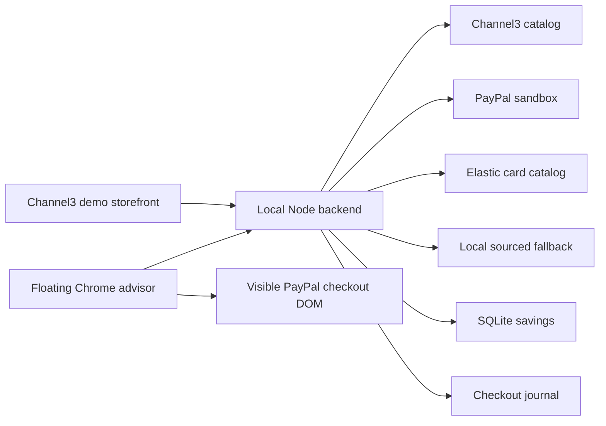

# Reward Harbor — Product and technical specification

Status: implemented sandbox MVP, with validation and future work tracked in [TASKS.md](TASKS.md).
Baseline: extension 0.10.0, reviewed 2026-11-12. This document supersedes conflicting descriptions in the original development plan.

## 1. Product goal

Help a shopper choose the card with the highest estimated reward for a purchase while they are on the PayPal payment portal. The extension is the main product. Harbor Market is a demo storefront used to exercise different purchase categories and the payment flow.

The shopper chooses the funding source and approves payment in PayPal. Reward Harbor recommends a card; it does not select a card or submit payment for the shopper.

## 2. Current scope

- Chrome Manifest V3 extension with a floating launcher and advisor window.
- PayPal sandbox checkout and the local demo store at port 3000 and https://reward-harbor.onrender.com.
- Channel3 product discovery on the storefront.
- Elastic as the primary issuer reward catalog, with a local catalog fallback.
- Two temporary sandbox card-product mappings.
- Estimated rewards, comparison of other available cards, and persistent estimated savings.

Live PayPal payments, arbitrary merchant support, automated card selection, actual issuer reward settlement, user accounts, and cross-device history are outside the current implementation.

## 3. Shopper flow and interface

1. Browse or search Channel3 products on Harbor Market. Departments cover grocery, food/treats, beauty/wellness, and home/tech scenarios.
2. Select a product, offer and quantity. The server refreshes price and availability and issues a checkout quote.
3. Click PayPal to open sandbox checkout. Log in using a sandbox personal account.
4. The floating advisor opens automatically when checkout is detected, including a login-to-checkout transition without a full reload. It must not repeatedly reopen after manual dismissal during the same checkout.
5. Read the best estimated card, masked card suffix, estimated reward value and rate. Expand Other available cards to compare alternatives. Expand card benefits or follow the official issuer source link when needed.
6. Select a card in PayPal and complete payment. The backend verifies capture before reporting payment success.
7. The store shows a small closable payment-success dialog with currency and amount, without the capture ID. The extension shows a closable savings dialog and updates its cumulative total.
8. After dismissing the receipt, the advisor shows only branding, estimated savings and the sandbox banner. It also uses this minimal state before reaching checkout.

### Interface requirements

- Independent navy/violet design, separate from the storefront.
- Floating window up to 340 px wide and 510 px tall, constrained by viewport size.
- Round launcher toggles the window; toolbar action can also toggle it on supported pages.
- Idle window shrinks to fit its header and banner. Checkout and receipt states expand it.
- Savings amount is larger and green; label is “Estimated savings”.
- Purchase details are automatic. No manual merchant, amount, category or card-product editing forms.
- Alternatives are collapsed by default. Best card appears before secondary controls.
- Successful payment headings include a checkmark. Unknown savings must not be displayed as a fabricated numeric value.
- Removing old completion reminders and assumptions lists from the UI does not change the calculation assumptions below.

## 4. Functional requirements

| ID | Requirement | Implementation |
| --- | --- | --- |
| FR-01 | Discover available products and current merchant offers | Channel3 server integration |
| FR-02 | Own prices and payment amounts on the server | Fresh quote and pre-order validation |
| FR-03 | Create and verify sandbox payments | PayPal create/capture/recovery flow |
| FR-04 | Detect visible funding cards | DOM extractor; no wallet enumeration API |
| FR-05 | Recover merchant, amount and category for the exact order | Session record, matching opener, server order context |
| FR-06 | Rank applicable card rewards | Sourced catalog and deterministic calculator |
| FR-07 | Explain alternatives and link issuer details | Collapsible cards and benefits |
| FR-08 | Open automatically after login | Route polling plus checkout detection |
| FR-09 | Recover a missed completion notification | Panel completion checks every 2.5 seconds while watching an order |
| FR-10 | Save incremental estimated savings without duplicates | SQLite quote snapshots and verified captures |
| FR-11 | Stop invalidated content scripts cleanly | Runtime guards and listener cleanup |

## 5. Card identity and reward rules

Only visible card labels and references are used. Full card numbers, BIN/IIN digits and issuer product tier are not available from the masked labels. Expiration and billing address are not needed for recommendations or savings storage.

Temporary mappings in `server/sandbox-card-mappings.mjs`:

| Visible sandbox card | Assumed reward profile |
| --- | --- |
| Amex ending 2402 | American Express Gold Card |
| Visa ending 6302 | Chase Freedom Unlimited |

These are demo assumptions, not product identities inferred from PayPal. Bank accounts are excluded from the card comparison. Matching network and suffix does not guarantee identity across accounts; references are used when available.

The sourced catalog includes Amex Gold, Platinum, Blue Cash Preferred and Chase Freedom Unlimited. The active panel calls `/api/best-card`; the older synthetic reward-rules calculator remains separate.

Calculation rules:

- Category rates replace base rates; do not add them twice.
- Membership Rewards points are valued at 1 US cent each for comparison.
- Bonus spending allowance is assumed unused; unsupported base rates remain unknown.
- Booking-channel and prepaid requirements must be satisfied before a bonus is applied.
- Missing merchant/category/amount must not produce a guessed recommendation.
- PayPal eligibility and issuer merchant classification remain unverified.
- Store departments supply simulated categories, not confirmed merchant category codes.
- Estimated reward value is distinct from incremental estimated savings.

## 6. Savings and persistence

The baseline is the initial observed funding selection for the order. The paid selection is recorded from the Pay click as `checkout-pay-click` evidence; never assume the recommended card was used.

`estimated savings = estimated reward for paid selection − estimated reward for baseline`

A known bank baseline is treated as zero card rewards. Negative differences are preserved. Unknown paid selection or baseline produces an unquantified transaction, excluded from the numeric total. All figures remain estimates rather than a checkout discount or confirmed issuer credit.

| Storage | Purpose |
| --- | --- |
| `.local-data/checkout.json` | Server-owned orders, checkout sessions, retry identifiers and capture state |
| `.local-data/rewards.sqlite` | Quote snapshots and verified reward transactions |
| Chrome local storage | Random installation history token |
| Chrome session storage | Per-order purchase context, baseline, selected funding evidence and receipts |
| `data/issuer-cards.json` | Sourced local catalog fallback |
| Elastic `card-catalog` | Primary reward-profile lookup |

SQLite stores installation-owner hashes, order/capture identifiers, purchase and recommendation snapshots, selected masked funding details, timestamps and integer reward/savings cents. Unique capture and owner/order constraints prevent duplicate counting. History is per installation, not an authenticated customer account. No PAN, CVV or PayPal password is required in these records.

## 7. Architecture and API

| Method | Route | Purpose |
| --- | --- | --- |
| GET | `/api/config`, `/api/health` | Public configuration and sandbox health |
| GET | `/api/storefront/products` | Department/search product listings |
| POST | `/api/storefront/quote` | Fresh product/offer/quantity quote |
| POST | `/api/paypal/orders` | Create a session-bound sandbox order |
| POST | `/api/paypal/orders/:id/capture` | Capture or reconcile payment |
| GET | `/api/checkout-context/:id` | Minimal exact-order context, limited to recent demo orders |
| GET | `/api/issuer-cards`, `/api/sandbox-card-mappings` | Sourced catalog and sandbox mappings |
| POST | `/api/best-card` | Rank observed cards; optionally record an order quote |
| GET | `/api/savings/summary` | Installation-scoped totals |
| POST | `/api/savings/finalize` | Persist verified completed transaction and return receipt |

PayPal mutations require the demo origin and session ownership. Savings routes require an installation bearer token. The order-context endpoint uses the opaque order ID as a local demo read capability; it is not a production authorization model.

The backend supports localhost and an explicitly configured HTTPS Render origin. The extension defaults to the hosted API and preserves the originating backend on local checkout records. `DATA_DIR` configures the journal and SQLite directory; use a Render persistent disk for hosted durability. Credentials stay in environment variables: `PAYPAL_CLIENT_ID`, `PAYPAL_CLIENT_SECRET`, `CHANNEL3_API_KEY`, `ELASTIC_URL`, `ELASTIC_API_KEY`, and `ELASTIC_CARD_INDEX`. Do not put secret values in source, docs, extension assets or browser responses.

## 8. Failure and lifecycle behavior

- Fresh Channel3 retrieval failure does not silently reuse stale offer prices.
- Changed prices require a new quote before ordering.
- Capture must be completed with matching amount and currency; pending or mismatched captures are not success.
- Elastic failure can use the local sourced catalog; the API retains fallback provenance.
- Purchase context is isolated by order and is cleared or marked terminal on completion, cancellation, failure or change.
- Lost merchant completion events are recovered against server capture state. Finalization retries are idempotent.
- Reloaded extensions require existing pages to be refreshed; expired scripts stop without uncaught context errors.
- Checkout journal is single-process local persistence. Multi-instance deployment is not supported.

## 9. Validation and release acceptance

Automated suites cover reward math, card extraction, exact-order context recovery, payment ownership and retries, savings idempotency, Channel3 freshness, extension lifecycle and browser UI with mocked Chrome/payment APIs.

Commands: `npm test`, `npm run test:browser`, and the separate live storefront inspection script. An authenticated unpacked-extension payment remains a manual acceptance gate; mocked browser tests do not certify every PayPal login or DOM variant.

Release acceptance: show recommendations for both mapped cards, preserve the current amount/category through popup focus and login, verify capture before receipt, count each transaction once, display an honest savings result, and keep idle/completed views compact. See [TASKS.md](TASKS.md) for the remaining validation work.
